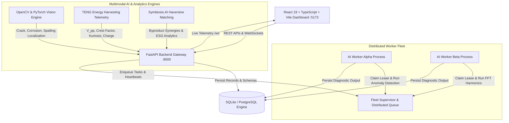

# Udyon — Intelligent Distributed Predictive Maintenance & Symbiosis Platform

> **Predict Failures. Prevent Disruptions. Eliminate Industrial Waste.**  
> *Core Mission:* Distributed AI, physical vibration modeling, computer vision defect localization, and industrial circularity to safeguard critical machinery and infrastructure.

---

## 1. Executive Summary

Industrial machinery downtime in energy utilities, water distribution, manufacturing plants, and cooling systems causes catastrophic financial and operational losses.

**Udyon** is an enterprise-grade predictive maintenance platform that fuses:
1. **Multivariate Physical Telemetry**: Vibration amplitude, temperature gradients, pressure dynamics, and FFT harmonics.
2. **Self-Powered TENG Sensing**: Triboelectric nanogenerator kinetic waveform analytics and energy harvesting metrics ($V_{pp}$, Kurtosis, Crest Factor, Charge).
3. **Computer Vision Defect Localization**: Calibrated physical ridge-trough crack localization, corrosion detection, and wear spalling segmentation.
4. **Symbiosis.AI Circular Waste Exchange**: An autonomous industrial ecology matching engine correlating factory byproducts with cross-industry feedstock demand.
5. **Distributed AI Architecture**: Multi-process worker fleet (`worker_alpha`, `worker_beta`) with lease-based fault recovery and cryptographic idempotency.

---

## 2. Quick Start: Local Hosting on Any Laptop

The repository is pre-configured with default offline SQLite databases and public demo telemetry to run immediately on any Windows, macOS, or Linux machine.

### Prerequisites
- **Python 3.10+** (Python 3.10, 3.11, or 3.12 recommended)
- **Node.js 18+** & **npm**
- **Git**

---

### Step 1: Clone the Repository
```bash
git clone https://github.com/invinciblekingg/udyon.git
cd udyon
```

---

### Step 2: Install Dependencies

#### Backend (Python):
```bash
# Optional: Create and activate virtual environment
python -m venv venv
# Windows:
venv\Scripts\activate
# macOS/Linux:
source venv/bin/activate

pip install -r requirements.txt
```

#### Frontend (React / Vite):
```bash
cd frontend
npm install
cd ..
```

---

### Step 3: Launch Local Platform

#### Option A: One-Click Launcher (Windows)
Double-click `start.bat` or run:
```cmd
start.bat
```

#### Option B: One-Click Launcher (macOS / Linux)
```bash
chmod +x start.sh
./start.sh
```

#### Option C: Python Universal Launcher (All Platforms)
```bash
python run_dev.py
```

`run_dev.py` automatically:
- Initializes `.env` from `.env.example` if not already present.
- Verifies storage directories (`storage/uploads`, `storage/annotated_images`, `storage/reports`).
- Seeds demo machine profiles across 8 industrial categories.
- Starts the FastAPI backend gateway on `http://localhost:8000`.
- Starts the React Vite frontend dashboard on `http://localhost:5173`.

---

## 3. Platform URLs

| Service | Local URL | Documentation / Endpoints |
| :--- | :--- | :--- |
| **Frontend Dashboard** | [http://localhost:5173](http://localhost:5173) | Interactive Diagnostic Studio & Vision Explorer |
| **FastAPI Backend Gateway** | [http://localhost:8000](http://localhost:8000) | Core Gateway API |
| **Interactive API Documentation** | [http://localhost:8000/docs](http://localhost:8000/docs) | Swagger UI for all 35+ API endpoints |
| **Health Check Endpoint** | [http://localhost:8000/api/health](http://localhost:8000/api/health) | Machine status and active distributed workers |

---

## 4. Verification & Testing

To verify that all services, AI models, and multimodal pipelines are functioning correctly:

```bash
# Run full end-to-end integration and verification suite:
python test_pipeline.py
```

The test script automatically verifies:
1. Backend Gateway Health & Database Connectivity
2. AI Computer Vision Crack & Defect Segmentation
3. Technician Defect Review & Re-annotation
4. Multimodal Fusion Bundle (Telemetry + Vision + TENG)
5. Consolidated High-Resolution PDF Engineering Report Generation
6. Frontend Single-Page Application (SPA) Serving

---

## 5. Technology Architecture



---

## 6. Project Directory Layout

```
udyon/
├── backend/                  # FastAPI Application Core
│   └── app/
│       ├── api/              # Routers: machines, vision, teng, telemetry, reports, alerts
│       ├── database.py       # SQLAlchemy ORM configuration
│       ├── main.py           # Application entrypoint & lifespan events
│       └── seed_data.py      # Demo machinery datasets & profile initialization
├── frontend/                 # React 19 + TypeScript + Vite Application
│   ├── src/
│   │   ├── pages/            # ImageAnalysis, Overview, ComponentExplorer, Symbiosis, etc.
│   │   ├── components/       # 3D Viewers, Modals, Navbar, Sidebar
│   │   └── services/         # API and Supabase clients
│   └── package.json
├── ml/                       # Machine Learning & Signal Processing Models
│   ├── image_detector.py     # Ridge-trough crack localization & defect analyzer
│   ├── models/               # Pre-trained lightweight PyTorch & Scikit-learn models
│   ├── models_def.py         # PyTorch neural architecture definitions
│   └── teng_analyzer.py      # TENG vibration energy harvester analyzer
├── demo_data/                # Industrial vibration CSVs and sample inspection images
├── storage/                  # Generated PDF reports, annotated images, uploads
├── run_dev.py                # Cross-platform development server runner
├── start.bat                 # Windows 1-click startup batch script
├── start.sh                  # Linux/macOS 1-click startup shell script
├── test_pipeline.py          # Comprehensive end-to-end verification script
└── requirements.txt          # Python dependencies
```

---

## 7. Safety & Advisory Notice

Udyon is engineered as decision-support software for predictive maintenance. Automated defect localization and telemetry flags should be verified by certified Non-Destructive Testing (NDT) professionals or licensed maintenance engineers before taking safety-critical equipment offline.
